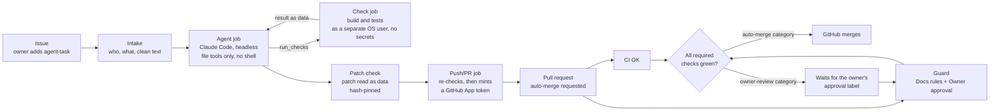

# Software Factory

**An issue goes in, a tested pull request comes out.**

Software Factory is an autonomous coding pipeline built on GitHub Actions. The repository owner labels
an issue. Claude Code, running headless (non-interactive, with no human at the keyboard), writes the
change. Separate, isolated jobs build, test and check it, and a trusted job opens the pull request. The
PR then merges by itself or waits for the owner, depending on a risk category that deterministic code
computes from the changed files.

**What this demonstrates**

- An AI coding agent that ships real pull requests (in a small demo project), with no human in the
  loop for low-risk changes.
- Guardrails that don't depend on the model behaving: least-privilege jobs, data-only checks and
  required checks that the agent can't bypass.
- Deterministic risk routing: low-risk changes merge by themselves, risky ones wait for a human.

> This repository is a presentation of the system: documentation, diagrams and a few simplified code
> excerpts. Nothing in it runs. The working system lives in a private repository.

## How it works

A PR merges only when three required checks are green: `CI OK` (build and tests), `Docs rules` (the
guard's hard rules on paths and workflow files) and `Owner approval` (the risk category). GitHub's
ruleset, the repository's merge rules, enforces this.

More detail: [architecture](docs/architecture.md).

## The flows

**Happy path.** The owner labels an issue ("add a method that returns the greeting in lower case, with
a test"). The agent edits the code and calls `run_checks` to build and test it in a separate job, at
most 5 rounds. The patch check gives the category `auto-merge`. A trusted job opens the PR with
auto-merge requested, and the issue gets a comment with the PR link. Once all three required checks
are green, GitHub merges it.

**Owner-review path.** The task adds a dependency to the build file. Everything runs the same way, but
the category is `owner-review: build-deps`, so `Owner approval` stays pending until the owner adds the
`owner-approved` label. A new push removes the label again.

**Failure and refusal paths.** Every step fails closed, and a label from anyone but the owner is
ignored. Intake refuses issues not written by the owner, an existing PR or branch, and a second
concurrent run. A denied file tool (say, a write under `.github/`) means the change is never made. The
patch check refuses forbidden paths, symlinks, binary files or an empty patch, so no PR opens. Each
stop posts a fixed-text reason on the issue. Once a PR exists, a red required check blocks the merge.

Both the happy path and the owner-review path have run end to end on live runs. The refusal of
forbidden paths and the flagging of removed tests are covered by unit tests.

## Risk categories

Every PR gets exactly one category, computed from its changed files and their contents by the same
rules in the patch check and the guard. A PR that matches several takes the strictest.

- `auto-merge`: source and tests inside the project's own package roots, docs.
- `owner-review: ...`: workflow files, agent instruction files, build files and dependencies, security
  config and build hooks, or fewer tests than before. These wait for the owner.

The full table and the rules behind it: [docs/risk-categories.md](docs/risk-categories.md).

## Security model in brief

- **Least-privilege token per job.** Each job's token has only the scopes it needs. Only the push/PR
  job acts as a separate identity, a GitHub App, and it mints that token only after its own re-checks.
- **The agent has no shell and no secrets in reach.** Managed settings deny `Bash` and confine file
  tools to the working directory. The copies of the pipeline scripts that actually run are root-owned
  and read-only, and it can't change them. Its only network tools are web reading and web search. Its
  tools can reach no credential it could send, and every URL and search is logged in the run summary.
- **Data-only patch check.** The agent's patch is parsed as data, its SHA-256 is pinned, and forbidden
  paths are refused before `git apply` runs.
- **No agent bypass of a failed guard.** Nothing in the pipeline merges directly. It only asks GitHub
  to auto-merge, and the App is not a bypass actor (an identity allowed to skip the ruleset), so a red
  or pending check always blocks.

Full model: [docs/security-model.md](docs/security-model.md).

## Honest limits

- **Java name-resolution tricks inside the project's own packages** are out of scope for the
  deterministic guard. They are left to review: an accepted risk today, with an independent AI review
  job planned.
- **Open web reading.** The agent can read the web for documentation. A prompt-injected agent could
  leak repository source through a URL. No credential is in its reach, and every URL is logged.
- **Risky changes need a human.** Nothing in an owner-review category merges without the owner's label.
- **An owner re-run is a merge.** Auto-merge stays armed while a check is red, so an owner re-run or
  branch update that turns everything green merges the PR.
- **Private repository, no fork PRs.** The guard's setup is safe only while no fork can open a PR.
- **Tuned for one stack.** The rules are written and tested for a Java 21 / Maven project; package
  roots and build-output folders are constants set per project.

## What's in the real system

The private repository holds a small Java 21 / Maven project and the complete pipeline that changes
it: five workflows, the trusted agent scripts, and one rules module shared by the patch check and the
guard. The scripts are Python (standard library, `python -I`) plus two small Bash wrappers, all
unit-tested. Claude Code is pinned, SHA-256 verified and installed without npm install scripts; every
action is pinned to a commit SHA; no workflow uses caches. Full layout:
[docs/architecture.md](docs/architecture.md#whats-in-the-real-system).

## Live demonstration

A live, end-to-end demonstration of the private system is available on request: contact me via my
GitHub profile.

---

© vkapustynskyi. All rights reserved.
