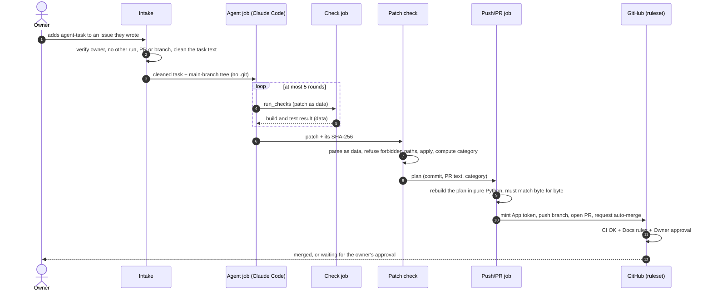

# Architecture

Software Factory is a set of GitHub Actions workflows plus a small set of trusted scripts. One run turns
one labelled issue into at most one pull request. Every job is a separate runner with its own token.
Every hand-over is a hash-pinned artifact or a job output, and agent-made content is only ever data.

## One run, step by step



## The jobs

| Job | What it does | What it holds |
|---|---|---|
| Credential mode | Reads which Claude credential mode is configured; any unknown value stops the run | Nothing |
| Intake | Re-checks the event through the API, refuses if a PR, branch or other run is in the way, cleans the issue text (hidden comments, invisible characters, encoded blobs, mentions), exports the main-branch tree | Read-only token |
| Agent | Installs a pinned Claude Code, installs managed settings from the main branch, drops sudo and Docker, runs Claude Code headless on the task, writes a run summary, makes the patch with clean git | Token to start the check job, identity token for the Claude credential (both out of the agent's reach) |
| Check | Applies the patch to a clean copy of the base commit and runs the build and tests as a separate system user; returns a capped result | Read token for one fetch, no secret |
| Patch check | Checks the patch as data, applies it with clean git, computes the category, prepares the commit and PR text | Read-only token, no secret |
| Push/PR | Re-checks all hashes, rebuilds the plan independently, then mints the GitHub App token, pushes the branch and opens the PR | The App key, in an environment limited to the main branch; a job token with no permissions |
| Report | Comments on the issue from fixed texts, with the PR link or the reason the run stopped | Issue write |

The agent's only build tool, `run_checks`, is an MCP server (Model Context Protocol, the standard way
to give Claude Code a tool). It takes no arguments: it makes the patch itself and starts the check job.

Outside the run, on every PR:

- **CI** builds and tests the PR and reports `CI OK`. It refuses re-runs started by anyone but the owner.
- **Guard** runs the base branch's guard on `pull_request_target`, reads the PR only as data, and
  posts `Docs rules` (hard path and workflow-file rules) and `Owner approval` (the risk category).

## Excerpt, simplified: jobs and permissions of the agent workflow

The real workflow is longer; owner checks, hashes and every step are left out here.

```yaml
on:
  issues:
    types: [labeled]          # the only trigger: no manual dispatch, no timer

permissions: {}               # nothing by default; each job asks for its own

jobs:
  intake:
    if: label is agent-task, sender is the owner (login AND pinned account id), type User
    permissions: { contents: read, issues: read, pull-requests: read, actions: read }

  agent:
    needs: intake
    concurrency: one agent run at a time
    permissions: { actions: write, id-token: write }   # start the check job, federated Claude login

  patch-check:
    needs: agent
    permissions: { contents: read }

  push-pr:
    needs: patch-check
    environment: main-branch only, holds the GitHub App key
    permissions: {}           # job token with no permissions

  report:
    needs: [intake, agent, patch-check, push-pr]
    permissions: { issues: write }
```

## Design choices

- **Only trusted code runs on agent output.** Every job of the run uses the main branch's copy of the
  pipeline scripts; in the agent job they sit in a root-owned, read-only folder. Agent-made code runs
  only in jobs that hold no secret and at most a read token: the isolated check job during the run, and
  CI on the PR.
- **No value from the event or the agent is put into a shell command by template expansion.** Values
  pass through environment variables only, and the guard enforces this rule on workflow files.
- **No agent-made text in job logs.** Claude's output goes to files; the scripts print fixed texts and
  neutralise what they write, so agent text can't inject runner commands.
- **Supply chain.** Claude Code is pinned to one version, SHA-256 verified, and installed without npm
  install scripts. Every action is pinned to a commit SHA. No workflow uses caches.
- **Re-runs never start the agent**, and every step fails closed on doubt.

## What's in the real system

The private repository holds a deliberately small Java 21 / Maven project and the complete pipeline
that changes it:

| Part | What it is |
|---|---|
| Agent workflow | The run: credential mode, intake, agent job, patch check, push/PR job, issue report |
| Check workflow | The isolated build-and-test job behind `run_checks`, with its hardening: sudo and Docker dropped, a separate system user, runner endpoints blocked, isolation tested before the build |
| CI workflow | The `CI OK` required check on every PR |
| Guard workflow | The `Docs rules` and `Owner approval` required checks, from the base branch's guard |
| Guard-tests workflow | Runs the unit tests of the pipeline's own scripts |
| Trusted agent scripts | Intake, the `run_checks` MCP server, patch maker, patch check, PR opener, settings renderer, run summary, credential helper, confinement smoke check, the agent's prompt and managed-settings template |
| Shared rules and guard | One rules module for paths and categories, used by both the patch check and the guard |

The scripts are Python (standard library, `python -I`) plus two small Bash wrappers, all covered by
unit tests.
