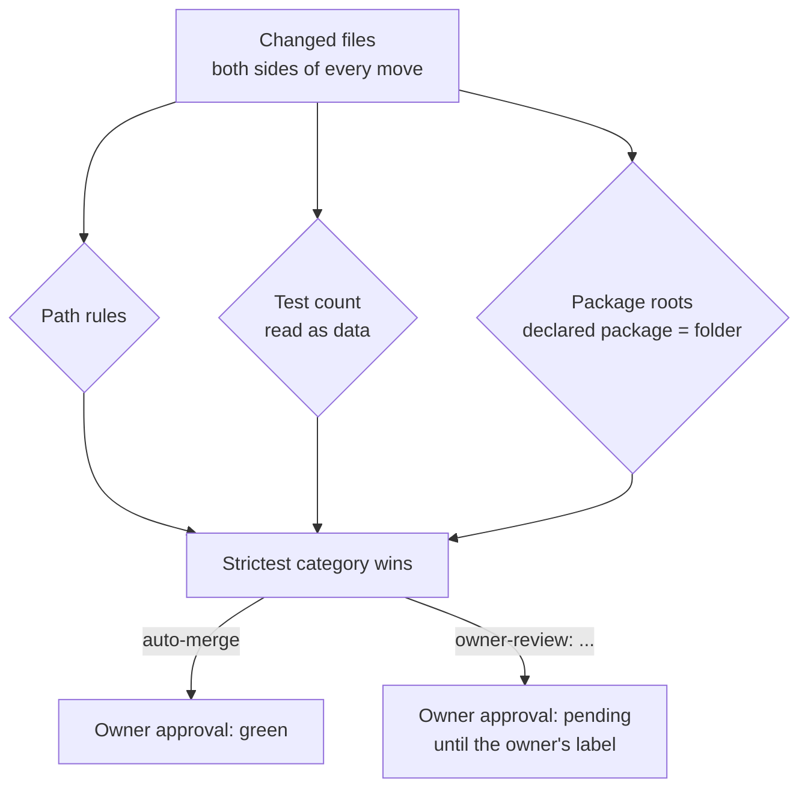

# Risk categories

Every pull request gets exactly one category. It is computed by trusted code from the PR's changed
files and, for test and source files, their contents read as data (never run). The patch check and the
guard share one rules module, so they apply the same rules. Labels only display the result; nothing
reads them to decide.



## The categories, strictest first

| Category | What puts a PR there |
|---|---|
| `owner-review: pipeline` | Workflow files, ruleset exports, `.gitattributes`, test-runner platform settings and service files |
| `owner-review: agent-instructions` | Files coding agents load as instructions: `CLAUDE*.md`, `AGENTS*.md`, `GEMINI*.md`, Cursor rules, `.claude/`, `.mcp.json`, `prompts/` |
| `owner-review: build-deps` | Build files and wrappers, build settings, lock files, package manifests and their config, Dockerfiles, compose files |
| `owner-review: security-config` | Application and security config, DB migrations, anything under `META-INF/`, compiled classes, sources outside the project's package roots or whose declared package differs from their folder, committed build output |
| `owner-review: tests-removed` | Fewer test methods than the base, a test file deleted without a similar new file, or a test file that can't be counted |
| `auto-merge` | Everything else: source and tests inside the package roots, docs, test fixtures |

An agent change under `.github/` or `.claude/` never becomes a PR: the patch check refuses it. Other
files in those categories become PRs and wait for the owner.

## Why `security-config` covers build hooks

A change can make every test meaningless while CI stays green, without touching the build file. For
example, a source file that declares a test-framework package can shadow the framework's assertion
class, and a service-loader file under `META-INF/` can make the compiler run code during the build. So
JVM sources must sit inside an allow-list of the project's own package roots, both by folder and by the
`package` line they declare, and the other hook files of the build go to the owner.

### Excerpt, simplified: how a category is decided

```python
PIPELINE, AGENT_INSTRUCTIONS, BUILD_DEPS, SECURITY_CONFIG, TESTS_REMOVED, AUTO_MERGE = ...
CATEGORIES = [PIPELINE, AGENT_INSTRUCTIONS, BUILD_DEPS, SECURITY_CONFIG, TESTS_REMOVED, AUTO_MERGE]

ANY_DIR = r"(?:.*/)?"
CATEGORY_PATTERNS = [
    (PIPELINE,           [ANY_DIR + r"\.github/.*", ANY_DIR + r"junit-platform\.properties"]),
    (AGENT_INSTRUCTIONS, [ANY_DIR + r"claude[^/]*\.md", ANY_DIR + r"\.mcp\.json"]),
    (BUILD_DEPS,         [ANY_DIR + r"pom\.xml", ANY_DIR + r"[^/]*\.lock"]),
    (SECURITY_CONFIG,    [ANY_DIR + r"migrations?/.*", ANY_DIR + r"meta-inf/.*"]),
]   # the real table has many more patterns per category

PACKAGE_ROOTS = ("<project.package>",)   # per-project setting

def path_categories(path):
    folded = fold(path)                  # Unicode NFC + casefold: no case tricks
    cats = [cat for cat, pats in COMPILED if any(p.fullmatch(folded) for p in pats)]
    if outside_package_roots(path) or in_build_output(path):
        cats.append(SECURITY_CONFIG)
    return cats

def strictest(cats):
    for cat in CATEGORIES:               # ordered strictest first
        if cat in cats:
            return cat
    return AUTO_MERGE
```

## The test-count rule

The number of test methods is read from the changed test files as data, never from a CI run, on both
the base and the head side. A drop in the count, a deleted test file with no similar new file, or any
file the counter can't read gives `tests-removed`. Moving or renaming a test file counts as an edit, not
a removal. The status shows the count, for example `tests 13 -> 12`.

### Excerpt, simplified: counting test methods

```python
TEST_ANNOTATIONS = {"Test", "ParameterizedTest", "RepeatedTest", "TestFactory", "TestTemplate"}

def count_test_methods(path, data):
    code = strip_comments_and_strings(path, data)    # raises on anything it can't tokenize
    refuse_test_annotation_declared(path, code)      # a home-made @Test type doesn't count
    bound = junit_bound_names(code)                  # names the imports really bind to JUnit
    count = 0
    for name in annotations(code):
        if name in QUALIFIED_TEST_ANNOTATIONS or (name in TEST_ANNOTATIONS and name in bound):
            count += 1
    return count

def tests_removed(changes):
    try:
        before = sum(count_test_methods(c.old_path, c.old_data) for c in changes if c.old_is_test)
        after = sum(count_test_methods(c.new_path, c.new_data) for c in changes if c.new_is_test)
    except TestCountError:
        return True                                  # fail closed: can't count, can't auto-merge
    return after < before or deleted_without_partner(changes)
```

## What the categories don't catch

File rules can't see what a change inside the project's own packages means, such as Java
name-resolution tricks inside those packages. These stay an accepted risk today; an independent AI
review job is planned for them. See the [honest limits](../README.md#honest-limits).
