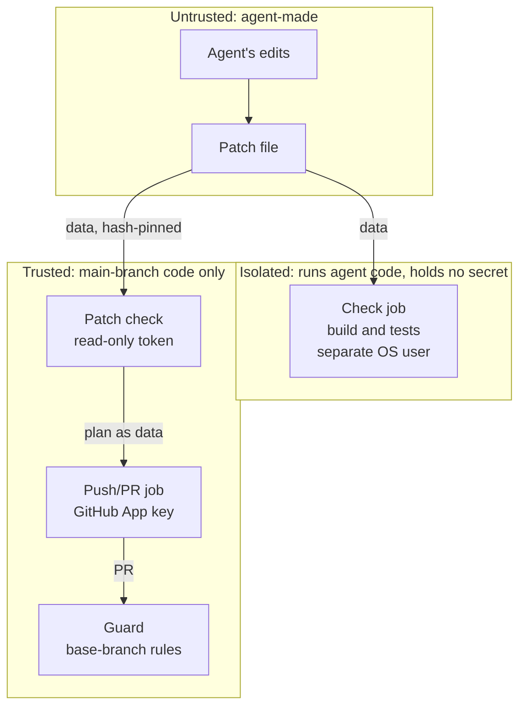

# Security model

The agent is treated as untrusted. Whatever it writes is data until trusted code from the main branch
has checked it, and no credential that can change the repository is ever in the agent's reach. The
issue text, the repository's own text, web pages and build output are not instructions. The agent's
prompt tells it to treat these as data, but nothing relies on that: everything it produces is checked
afterwards as untrusted.

## Trust boundaries



## The agent's confinement

- **No shell.** Claude Code runs headless with managed settings that deny `Bash`, and the command line
  denies it again. To build and test, the agent calls one tool, `run_checks`, which takes no arguments:
  the tool makes the patch itself and starts the isolated check job. At most 5 calls per run.
- **File tools confined to the working directory.** Writes under `.git`, `.github` and `.claude` are
  denied, and so are agent and git config files (`CLAUDE.md`, `.mcp.json`, `.gitattributes`,
  `.gitmodules`) and editor and dev-container config. Reading `.env` files is denied.
- **No secrets in reach.** The folders that hold the job token, the identity-token file and the runner's
  own files are denied too. Their deny rules are derived from the runner's real paths at run time and
  verified again right before Claude starts; a mismatch stops the job.
- **Only managed rules count.** Rules from the working tree can't add permissions, bypass mode is
  disabled, and the settings are validated before the run, because headless mode would silently ignore
  an invalid settings file.
- **Clean environment.** Claude Code starts under `env -i` with an allow-list, so no other credential,
  token or provider switch can be present.
- **Network.** Its only network tools are web reading and web search. Its tools can reach no credential
  it could send, and every URL and search is logged in the run summary.
- **Confinement smoke test.** A confinement smoke task attempts every denied access, and a
  checker fails unless each one is denied.

### Excerpt, simplified: the managed settings

The full file has more rules of the same kind; the runner-specific folders are added at run time.

```jsonc
{
  "allowManagedPermissionRulesOnly": true,
  "allowManagedHooksOnly": true,
  "permissions": {
    "defaultMode": "dontAsk",
    "disableBypassPermissionsMode": "disable",
    "allow": [
      "Read(./**)", "Edit(./**)", "Write(./**)", "Glob(./**)", "Grep(./**)",
      "WebFetch", "WebSearch", "mcp__checks__run_checks"
    ],
    "deny": [
      "Bash",
      "Edit(./**/.git/**)", "Write(./**/.git/**)",
      "Edit(./.github/**)", "Write(./.github/**)",
      "Edit(./**/.claude/**)", "Write(./**/.claude/**)",
      "Edit(./**/CLAUDE.md)", "Write(./**/CLAUDE.md)",
      "Read(./**/.env*)"
      // Edit and Write also denied for the other agent and git config files and editor config;
      // all file tools denied on system folders (/proc, /etc, /dev, /sys, /run, /var/log)
    ]
  }
}
```

## The isolated check job

The check job runs the agent's code (its tests), so it is built to hold nothing worth stealing: no
secrets, no environment, no caches, and no actions at all (plain shell steps only). Before any
repository code runs it drops sudo and Docker, and the build runs as a separate system user with no
access to the runner's processes, files or credentials. This isolation is checked on every run, not
assumed. The job keeps network access, which the build tool needs to fetch dependencies.

## The patch check

- The patch's SHA-256 is fixed once in the agent job and checked again by every later job.
- The file list is read by the pipeline's own strict parser before `git apply` runs. A change under
  `.git/`, `.github/` or `.claude/` (any depth, any case) or to `.gitmodules` is refused outright, and so
  are symlinks, submodules, mode changes, binary files, control and bidi characters, oversized files,
  and paths that differ only by case.
- `git apply` runs with clean git: a fresh, empty git directory, no system or global config, no hooks.
- The push/PR job holds the App key from its start, so it runs no git on agent data at all. It rebuilds
  the commit plan in pure Python and requires it to match the patch check's plan byte for byte, and only
  then mints the token.

## Credentials

- **Claude, API mode.** The agent job trades GitHub's OIDC token for a short-lived Claude API token
  through workload identity federation, pinned to the repository, its main branch and the agent
  workflow. No Claude API key is stored anywhere.
- **Claude, subscription mode.** An optional mode uses an OAuth token kept in an environment limited to
  the main branch, used only by the subscription variant of the agent job. Only the chosen credential
  ever enters a job.
- **GitHub App.** Its token can write contents and pull requests of this one repository only: no
  workflow files, no administration. The job pins the repository's name and immutable id, so a
  repository re-created under the same name stops it.

## The merge gate

- The ruleset (GitHub's merge rules for the main branch) requires `CI OK`, `Docs rules` and
  `Owner approval` on the PR's head, and an up-to-date branch. It requires no review, and the App is
  not a bypass actor (an identity allowed to skip the ruleset).
- **No agent bypass of a failed guard.** Nothing in the pipeline merges directly; it only requests
  GitHub's auto-merge, so a red or pending check always blocks.
- The guard runs the base branch's copy of its script and reads the PR only as data, so a PR can't change
  the rules that judge it. Labels are display only; the category is always recomputed.
- **Owner-only approval.** An owner-review PR turns green only through the owner's own `owner-approved`
  label: the guard reads who added it from GitHub's label events (the owner's login, as a user, not
  through an app). A label that doesn't count is removed with a comment, and every new push removes it.
- `CI OK` fails on any re-run not started by the owner.

See the [honest limits](../README.md#honest-limits) for what this model does not cover.
